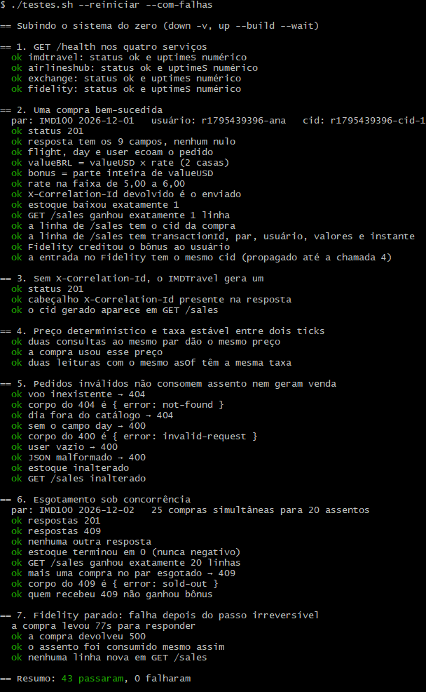
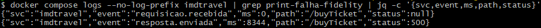
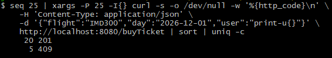

# Evidências de Testes — IMDTravel (Parte 1: BASELINE)

Este documento reúne os resultados, saídas e capturas de tela da suíte de verificação funcional e dos cenários de falhas do sistema **IMDTravel** (Parte 1: Linha de Base, sem tolerância a falhas).

---

## 1. Execução Completa: `./testes.sh --reiniciar --com-falhas`

O script derrubou o ecossistema, apagou o volume (`down -v`), subiu os containers com o `imdtravel` local compilado (`up -d --build --wait`) e executou todos os testes ponta a ponta (43 passaram, 0 falharam):



### Saída textual consolidada:
```text
$ ./testes.sh --reiniciar --com-falhas

== Subindo o sistema do zero (down -v, up --build --wait)

== 1. GET /health nos quatro serviços
  ok imdtravel: status ok e uptimeS numérico
  ok airlineshub: status ok e uptimeS numérico
  ok exchange: status ok e uptimeS numérico
  ok fidelity: status ok e uptimeS numérico

== 2. Uma compra bem-sucedida
  par: IMD100 2026-12-01   usuário: r1795439396-ana   cid: r1795439396-cid-1
  ok status 201
  ok resposta tem os 9 campos, nenhum nulo
  ok flight, day e user ecoam o pedido
  ok valueBRL = valueUSD × rate (2 casas)
  ok bonus = parte inteira de valueUSD
  ok rate na faixa de 5,00 a 6,00
  ok X-Correlation-Id devolvido é o enviado
  ok estoque baixou exatamente 1
  ok GET /sales ganhou exatamente 1 linha
  ok a linha de /sales tem o cid da compra
  ok a linha de /sales tem transactionId, par, usuário, valores e instante
  ok Fidelity creditou o bônus ao usuário
  ok a entrada no Fidelity tem o mesmo cid (propagado até a chamada 4)

== 3. Sem X-Correlation-Id, o IMDTravel gera um
  ok status 201
  ok cabeçalho X-Correlation-Id presente na resposta
  ok o cid gerado aparece em GET /sales

== 4. Preço determinístico e taxa estável entre dois ticks
  ok duas consultas ao mesmo par dão o mesmo preço
  ok a compra usou esse preço
  ok duas leituras com o mesmo asOf têm a mesma taxa

== 5. Pedidos inválidos não consomem assento nem geram venda
  ok voo inexistente → 404
  ok corpo do 404 é { error: not-found }
  ok dia fora do catálogo → 404
  ok sem o campo day → 400
  ok corpo do 400 é { error: invalid-request }
  ok user vazio → 400
  ok JSON malformado → 400
  ok estoque inalterado
  ok GET /sales inalterado

== 6. Esgotamento sob concorrência
  par: IMD100 2026-12-02   25 compras simultâneas para 20 assentos
  ok respostas 201
  ok respostas 409
  ok nenhuma outra resposta
  ok estoque terminou em 0 (nunca negativo)
  ok GET /sales ganhou exatamente 20 linhas
  ok mais uma compra no par esgotado → 409
  ok corpo do 409 é { error: sold-out }
  ok quem recebeu 409 não ganhou bônus

== 7. Fidelity parado: falha depois do passo irreversível
  a compra levou 77s para responder
  ok a compra devolveu 500
  ok o assento foi consumido mesmo assim
  ok nenhuma linha nova em GET /sales

== Resumo: 43 passaram, 0 falharam
```

---

## 2. Dependências Fora do Ar: AirlinesHub e Exchange

Na Parte 1, o sistema **não possui timeouts configurados**, não possui retries nem caminhos alternativos. Quando um serviço dependente cai, a chamada HTTP aguarda o sistema operacional/rede desistir ou recusa de conexão imediata, devolvendo **HTTP 500**.

### 2.1 AirlinesHub Parado
- **Cenário:** `docker compose stop airlineshub` e envio de compra com `X-Correlation-Id: teste-airlines-down-1`.
- **Resultado:** Retornou **HTTP 500** após **8 segundos** (tempo até o timeout de conexão do cliente HTTP / OS).
- **Logs estruturados (`imdtravel`):**
```json
{"ts":"2026-11-23T12:53:51.845262981Z","svc":"imdtravel","cid":"teste-airlines-down-1","event":"requisicao.recebida","ms":0,"method":"POST","path":"/buyTicket"}
{"ts":"2026-11-23T12:53:59.858446070Z","svc":"imdtravel","cid":"teste-airlines-down-1","event":"resposta.enviada","ms":8013,"method":"POST","path":"/buyTicket","status":500}
```

### 2.2 Exchange Parado
- **Cenário:** `docker compose stop exchange` e envio de compra com `X-Correlation-Id: teste-exchange-down-1`.
- **Resultado:** Retornou **HTTP 500** em **5 ms** (recusa de conexão imediata `Connection Refused`).
- **Logs estruturados (`imdtravel`):**
```json
{"ts":"2026-11-23T12:54:08.431539515Z","svc":"imdtravel","cid":"teste-exchange-down-1","event":"requisicao.recebida","ms":0,"method":"POST","path":"/buyTicket"}
{"ts":"2026-11-23T12:54:08.437433334Z","svc":"imdtravel","cid":"teste-exchange-down-1","event":"resposta.enviada","ms":5,"method":"POST","path":"/buyTicket","status":500}
```

---

## 3. Fidelity Parado: Falha Após Passo Irreversível (Inconsistência Observada)

Um dos pontos centrais da Parte 1 é observar o defeito de projeto: a chamada ao Fidelity está no caminho crítico **após** o consumo do assento no AirlinesHub. Se o Fidelity falhar:
1. O assento no AirlinesHub já foi consumido (`POST /sell` deu 201).
2. A compra no IMDTravel falha com **500**.
3. **Nenhuma linha é gravada em `/sales`**.

### Execução e Evidência
- **Voo/Dia:** `IMD100` em `2026-12-06` (Estoque inicial: 20 assentos).
- **Ação:** Parou o Fidelity (`docker compose stop fidelity`) e disparou compra com `X-Correlation-Id: print-falha-fidelity`.
- **Resultado do `POST /buyTicket`:** Devolveu **HTTP 500** após **8.3 segundos**.
- **Estoque final no AirlinesHub:** O assento baixou de 20 para 19.
- **Consulta em `GET /sales` buscando o CID:** Retornou lista vazia `[]` (nenhuma linha gravada).
- **Logs estruturados capturados do container (`imdtravel`):**



```json
{"svc":"imdtravel","event":"requisicao.recebida","ms":0,"path":"/buyTicket","status":null}
{"svc":"imdtravel","event":"resposta.enviada","ms":8344,"path":"/buyTicket","status":500}
```

---

## 4. Esgotamento sob Concorrência (25 Compras Simultâneas para 20 Assentos)

Verificação da consistência transacional do estoque do AirlinesHub e do registro local de vendas sob alta concorrência:

- **Voo/Dia testado:** `IMD300` em `2026-12-01` (20 assentos disponíveis).
- **Carga:** 25 requisições `POST /buyTicket` enviadas simultaneamente (`seq 25 | xargs -P 25`).
- **Distribuição dos códigos HTTP:**
  - **20** respostas `201 Created`
  - **5** respostas `409 Conflict` (`{"error":"sold-out"}`)
  - **0** erros inesperados



- **Estoque no AirlinesHub após a carga:** Encerrou exatamente em **0** (nunca negativo).
- **Linhas gravadas em `/sales`:** Exatamente **+20** linhas inseridas.
- **Tentativa posterior no par esgotado:** Retorna `HTTP 409` com corpo `{"error":"sold-out"}`.
